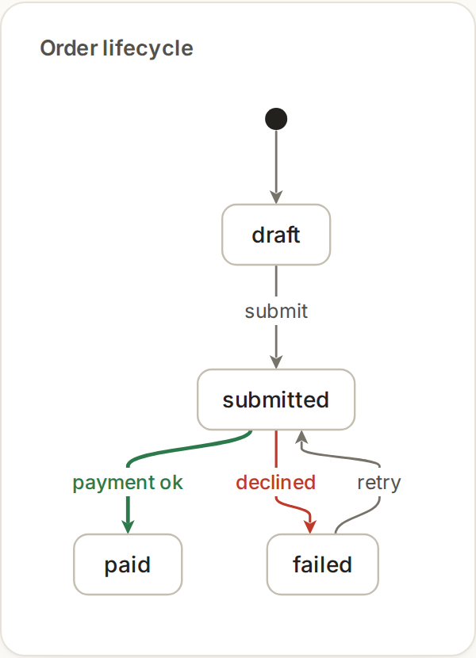

# Press

Press is Markdown with diagram fences. You write the nodes, edges, and what they mean. Press does the layout and the drawing. Roles (`focus`, `error`, `happy`, `muted`) say what something is, not how it looks.

````markdown
```state-machine id=order title="Order lifecycle"
start -> draft
draft -> submitted : submit
submitted -> paid : payment ok {role=happy}
submitted -> failed : declined {role=error}
failed -> submitted : retry
```
````



On screen, a `steps` block is a walkthrough with next and previous. Print keeps the diagram as one frame, with numbered markers for the steps. `press preview` draws the document in the terminal.

Need Node 26 or later. `npm install`, then `node src/cli.ts build doc.md --out-dir out` for HTML, `-o doc.pdf` for PDF (Typst on PATH), and `node src/cli.ts preview doc.md` for the terminal. The language is in [`docs/SPEC.md`](docs/SPEC.md). Examples are in [`docs/examples`](docs/examples).

## Diagram types

- `state-machine`: states and transitions
- `sequence`: messages between participants over time
- `architecture`: components, boundaries, connections
- `c4`: people, systems, and containers
- `deployment`: where software runs
- `data-flow`: how data moves and transforms
- `er`: entities and relationships
- `timeline`: events in order
- `causal-loop`: feedback loops with polarity
- `decision-tree`: choices and outcomes
- `tradeoffs`: options compared across criteria
