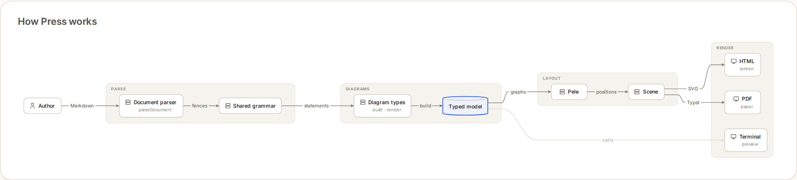

# Press

A small Markdown-like language for explanations that mix prose and diagrams. You write
structure; Press handles layout, typography and visual design.



How the pieces fit together, drawn in Press.
Source: [`docs/how-press-works.md`](docs/how-press-works.md).

````markdown
```state-machine id=order title="Order lifecycle"
start -> draft
draft -> submitted : submit
submitted -> paid : payment ok {role=happy}
submitted -> failed : declined {role=error}
failed -> submitted : retry

steps:
  draft -> submitted     "The user submits the cart"
  submitted -> failed    "The card is declined"
  failed -> submitted    "They retry with a new card"
```

When the card is declined, [the failed state](#order.failed) loops back.
````

The output is one self-contained HTML file:

- **On screen**, steps become a walkthrough: next and previous, with the current edge
  highlighted and a caption. `#order/2` links straight to step 2. Hovering a prose
  reference points at its node.
- **On paper**, each diagram prints as a single frame. Steps become numbered markers with
  a caption legend, prose references become lettered markers, and diagrams never split
  across pages.

The language is defined in [`SPEC.md`](docs/SPEC.md). [`VISUALIZATIONS.md`](docs/VISUALIZATIONS.md)
lists the diagram types, and [`docs/examples/`](docs/examples) has complete explanations.

## Use

Press needs Node 26 or later.

```sh
npm install
node src/cli.ts build docs/examples/checkout.md --out-dir out   # HTML
node src/cli.ts build doc.md -o doc.pdf                    # PDF, typeset by Typst (needs typst on PATH)
node src/cli.ts build doc.md -o doc.webp                   # each figure as a tight WebP (needs typst)
node src/cli.ts build doc.md -o doc.png                    # same drawing as PNG; also .jpg and .svg
node src/cli.ts check doc.md                               # problems only
node src/cli.ts preview doc.md                             # read it in the terminal
```

`press preview` draws the whole document in the terminal, figures included, laid out for the
terminal's width. It is dark by default, plain text when piped, and `--ascii` avoids box-drawing
characters.

Inside the clone, `npx press …` runs the same CLI. npm never links a package's own `bin`
into its `node_modules/.bin`, so there is no `node_modules/.bin/press`. To get a `press`
command everywhere, run `npm link` (or `npm install -g .`) once in the clone.

Problems are reported with the line and a fix, so an LLM can correct its own source:

```
doc.md:12: error: Unknown role `danger`.
  fix: Did you mean `role=error`? Roles: `focus`, `error`, `happy`, `muted`.
```

From code:

```ts
import { build } from './src/index.ts';
const { html, diagnostics } = build(markdown);
```

## For agents

[`skills/press/SKILL.md`](skills/press/SKILL.md) teaches an agent to explain a codebase or a
change with Press: read the code first, find the claims worth drawing, build the picture up,
and show a PR as one diagram with `+` and `-` lines.
[`references/language.md`](skills/press/references/language.md) is the language itself, with
what each diagram type is for and where it hides in code. Every diagram in the skill is built
by the test suite, so it stays in step with the language.

Two skills cover one job each.
[`skills/press-guide`](skills/press-guide/SKILL.md) writes a guide to a whole project as a PDF:
why it exists, what it is made of, what it remembers, what happens when it runs and fails, and
how people work on it. [`skills/press-pr`](skills/press-pr/SKILL.md) makes one image of what a
pull request does to the system, from a fingerprint of the dimensions it changes.

## Develop

```sh
npx playwright install chromium   # once, for the browser tests
npm test            # parser, rendering, and browser checks
npm run check       # format check, lint, typecheck
npm run build:examples
```

Node runs the TypeScript directly, so there is no build step. Layout for graph diagrams
is pele's layered layout, vendored in `src/layout/pele` (MIT); see `docs/PRIOR_ART.md` for why.
Fonts are Geist Sans, Geist Serif and Geist Mono from [vercel.com/font](https://vercel.com/font) (SIL OFL), embedded in each page.
Vendor icons in `assets/icons` (AWS, Azure, Google Cloud, Kubernetes) belong to their vendors and are
not MIT; see [`assets/icons/NOTICE.md`](assets/icons/NOTICE.md).
