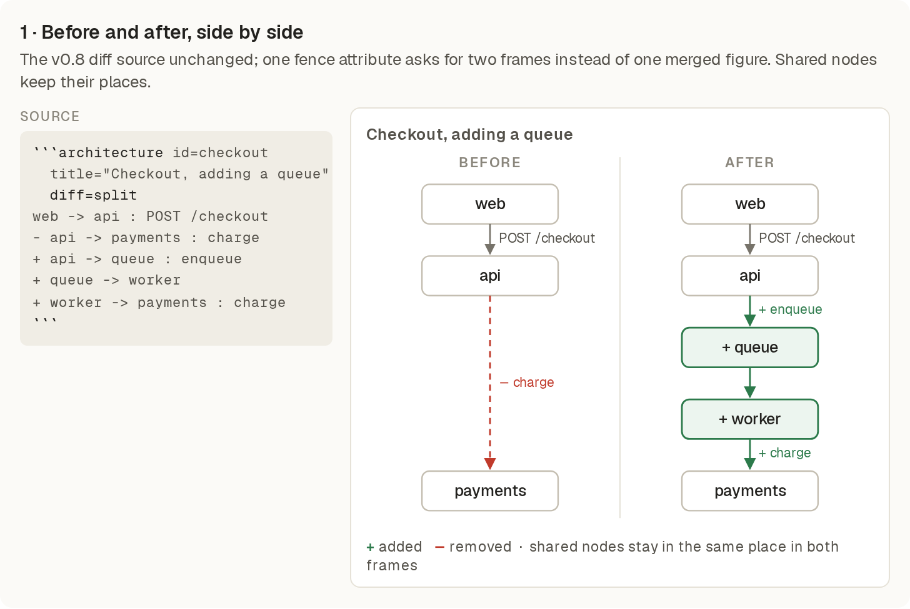
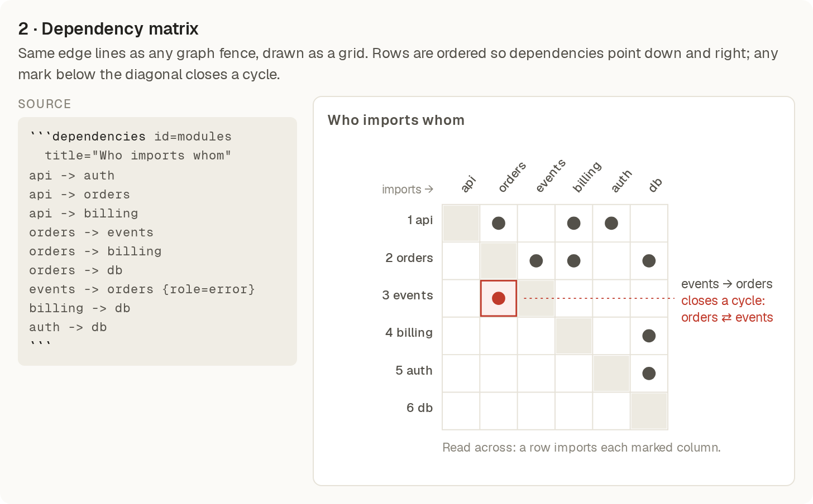
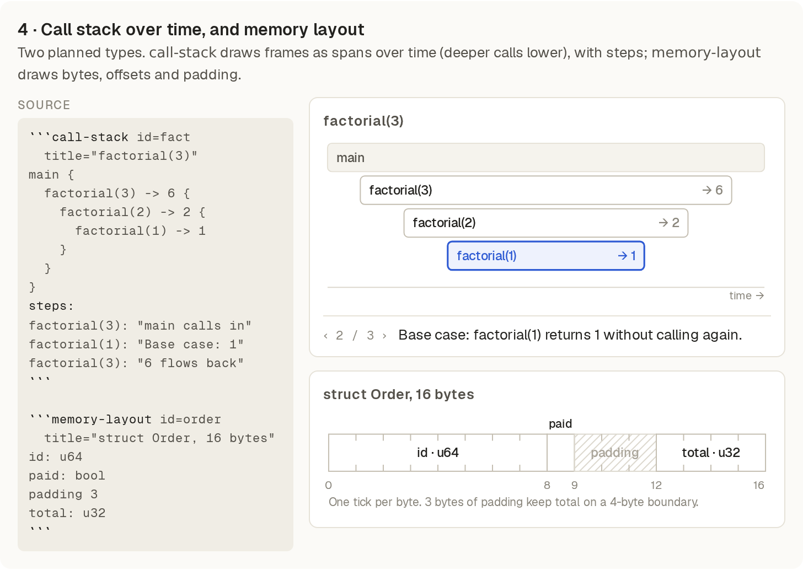

# Visualization ideas: examples

Four ideas for showing things in Press, each drawn as a static mockup so the look can be judged before any code exists. Each one is a proposal. The spec section for `call-stack` and `memory-layout` is in `docs/SPEC.md` as a draft; the other two need their spec written first.

The mockups are hand-drawn SVG in Press's palette and Geist type. They show the intended look, not Press's renderer output.

## 1. Before and after, side by side

Reuses the v0.8 `+` and `-` diff syntax unchanged. One attribute asks for two frames instead of one merged figure.

```architecture id=checkout title="Checkout, adding a queue" diff=split
web -> api : POST /checkout
- api -> payments : charge
+ api -> queue : enqueue
+ queue -> worker
+ worker -> payments : charge
```



Open question: width. Two wide frames will not fit a 680px page column. Proposed rule: side by side for `direction=down` figures, stacked for `direction=right`, and stacked in print and the terminal whenever the frames would print below a readable size. Merged stays the default.

## 2. Dependency matrix

A new type, `dependencies`. It uses the same edge lines as a graph fence and draws them as a grid: a row depends on each column it marks. Rows and columns are ordered so dependencies fall above the diagonal, and any mark below the diagonal closes a cycle, which is drawn in the error role.

```dependencies id=modules title="Who imports whom"
api -> auth
api -> orders
api -> billing
orders -> events
orders -> billing
orders -> db
events -> orders {role=error}
billing -> db
auth -> db
```



Open question: ordering. Reading order is only a tie-break here, so the ordering rule needs its own spec text. Column names are slanted to fit; long names may need wrapping or a legend.

## 3. Code with callouts (not pursued)

Dropped after review. Inline review comments already do this job, and Press figures explain structure and behaviour rather than annotate source lines. No mockup is included.

## 4. `call-stack` and `memory-layout`

Both were already planned in `docs/VISUALIZATIONS.md`. The syntax is in `docs/SPEC.md` under "Diagram types in v0.9 (draft, not yet agreed)".

```call-stack id=fact title="factorial(3)"
f3: "factorial(3)"
f2: "factorial(2)"
f1: "factorial(1)"

main -> f3
f3 -> f2
f2 -> f1
f1 --> f2 : 1
f2 --> f3 : 2
f3 --> main : 6

steps:
  main -> f3     "main asks for 3!"
  f2 -> f1       "Each call waits on a smaller one"
  f1 --> f2      "The base case returns without calling again"
  f3 --> main    "The answers multiply on the way back"
```



```memory-layout id=order title="struct Order, 16 bytes"
order: "Order"
order.id : u64
order.paid : bool
order.pad : padding {size=3}
order.total : u32
```

Press does not compute padding. The author writes it, and Press warns when a field is misaligned.

## Decisions to confirm

- Before/after: the placement rule above.
- Dependency matrix: whether it is a new type or a `tradeoffs`-style grid, and its ordering rule.
- `call-stack`: calls and returns as edges, and only the top frame may call or return.
- `memory-layout`: the author writes padding; rows are 8 bytes.
